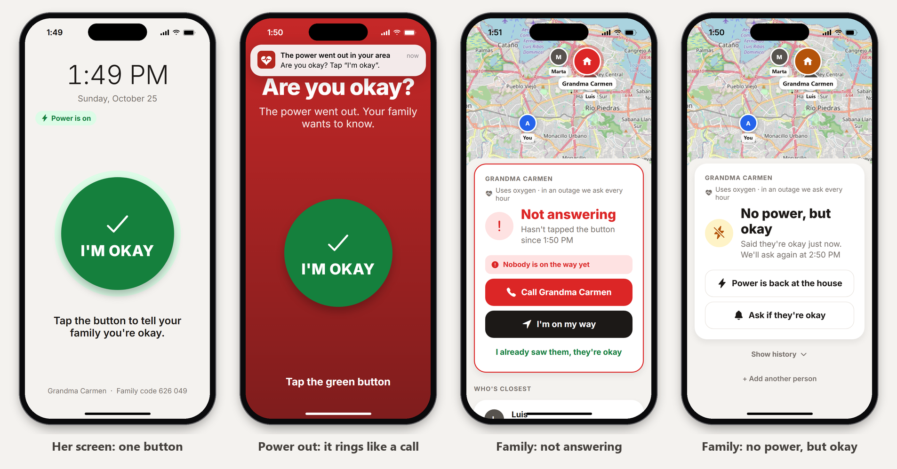

# RedVita

RedVita alerts family and neighbors when someone who needs electricity to stay alive doesn't check in during a blackout.



<sub>Screenshots from the phone simulator in [demo/](demo/).</sub>

## The problem

In Puerto Rico, 44,483 Medicare beneficiaries use medical equipment that runs on electricity at home, like oxygen machines and home dialysis ([HHS emPOWER map](https://empowerprogram.hhs.gov/empowermap), October 2026). In August 2024 LUMA, the island's power company, said it had only about 3,000 of them registered, and the Health Department still had no list of who needs to be checked on when the power goes out ([Centro de Periodismo Investigativo](https://periodismoinvestigativo.com/en/2024/08/electricity-dependent-list-blackouts/)).

Blackouts happen often, and the people at most risk are usually older and alone. RedVita turns the patient's own phone into a check-in system that runs through the people who already care about them.

## How it works

1. **Someone says the power went out.** A family member, neighbor or caregiver taps **Power went out at the house** on the patient's card. RedVita asks her right away, plus any other RedVita patient within 1.5 km of her home. It works from anywhere (family doesn't have to live nearby) and even when her phone isn't plugged in. The report is tied to her house, which the server already knows, so nobody can send a fake location to find vulnerable people, and the reporter never sees who else was asked.
2. **Optional: the charger.** If the patient's phone always stays plugged in, turn on **Detect outages with the charger** during setup. Then the phone also notices by itself when it stops charging.
3. The patient's phone rings a loud alarm that looks like an incoming call, with one giant green button, **I'M OKAY**. The button is also right on the lock-screen notification.
4. If nobody presses it within 10 minutes, every linked family member, neighbor and caregiver gets a loud push alert and a text message (SMS still arrives when cell data is down).
5. While the power stays out, the phone asks again on a schedule set by what she needs electricity for, chosen at setup: every hour for oxygen or a breathing machine, every 2 hours for home dialysis, every 4 hours for medicine in the fridge or an electric bed. It keeps asking even with no internet. Urgent alerts say what's at stake: "Grandma Carmen (uses oxygen) hasn't answered the check-in…".
6. If the patient's phone goes silent during the outage (dead battery, no signal) for 45 minutes, family is alerted too, and told again when it's back.
7. **Power is back at the house** ends the outage for the area. An unanswered check-in stays open until she presses the button or someone visits.
8. Everyone linked gets the alert at once, so the card shows **Nobody is on the way yet** in red until someone taps **I'm on my way**. Then the others see who's going.
9. Family sees the patient's home on a map with who's closest, and only the buttons that make sense right now: **Call**, **I'm on my way** (opens directions and tells the others), or **I saw them: they're okay** after visiting in person, which counts as the check-in for patients who can't use a phone.

Alerts go only to the people the patient's family chooses.

### Built to work in a blackout

- **Local first.** The patient's phone schedules its own alarms, so the alarm and button work with no internet. A check-in made offline is saved and sent when signal returns.
- **Server watchdog.** A job runs every minute on the server and alerts family about missed check-ins. It doesn't depend on the patient's phone being online, which is the whole point.
- **Two alert channels.** Push notifications (free) plus SMS backup. If an urgent alert reaches nobody, the server retries it the next minute.
- **Honest timestamps.** A press made offline counts at the moment it was pressed, so a late-arriving press can't wrongly tell family she's okay about a newer check-in.
- **No double alerts.** Every change to a patient's record is versioned, so the every-minute watchdog and the app can't overwrite each other.
- **Codes can't be guessed.** Wrong 6-digit codes are rate limited per connection.

## Built with

| Part | Tools |
| --- | --- |
| App | TypeScript, React Native, Expo SDK 58, Expo Router |
| Map | Leaflet + OpenStreetMap in react-native-webview (free, no API key); home locations taken once with expo-location |
| Phone features | expo-battery (charger state), expo-notifications (alarm channel, exact alarms), expo-background-task, expo-audio, expo-secure-store |
| Server | Supabase (Postgres + Deno edge functions), pg_cron |
| Alerts | Expo Push Service, Twilio SMS |
| Tests | Node test runner (40 tests on the check-in rules, phone and server) |

```
src/app/            screens (setup, patient, family)
src/lib/rules.ts    phone-side check-in rules (tested)
src/lib/patient.ts  charger watching, local alarms, background checks
supabase/functions/_shared/logic.ts   server-side rules (tested)
supabase/functions/api                endpoints the app calls
supabase/functions/watchdog           runs every minute, sends alerts
supabase/migrations                   database tables
demo/               try the app in a browser, no phones or accounts (see demo/README.md)
```

## Run it (all free)

You need free accounts at [Supabase](https://supabase.com), [Expo](https://expo.dev), [Firebase](https://console.firebase.google.com) (for Android push) and optionally [Twilio](https://www.twilio.com/try-twilio) (SMS).

### 1. Server

```bash
npm install
npx supabase login
npx supabase link --project-ref YOUR-PROJECT-REF
npx supabase db push
npx supabase secrets set WATCHDOG_SECRET=make-up-a-long-random-string
npx supabase functions deploy api --no-verify-jwt
npx supabase functions deploy watchdog --no-verify-jwt
```

Then open `supabase/cron.sql`, put in your project ref and the same watchdog secret, and run it in the Supabase SQL editor. That starts the every-minute check. Don't save your real secret back into the file.

**SMS (optional, free trial):** Twilio's trial gives free credit and a phone number, but only texts numbers you verify in the Twilio console. Fine for testing with your own family.

```bash
npx supabase secrets set TWILIO_ACCOUNT_SID=AC... TWILIO_AUTH_TOKEN=... TWILIO_FROM=+1...
```

Without these, RedVita still sends push alerts and simply skips SMS.

**Demo mode:** `npx supabase secrets set GRACE_MINUTES=1` makes family alerts fire after 1 minute instead of 10. Unset it for real use: `npx supabase secrets unset GRACE_MINUTES`.

### 2. App

```bash
cp .env.example .env               # paste your api function URL
npx eas-cli@latest login
npx eas-cli@latest init            # writes your projectId into app.json
```

Android push needs a Firebase project (free): create one, add an Android app with package `pr.redvita.app`, then upload its service account key with `npx eas-cli@latest credentials` (Android → Push Notifications: FCM V1).

Build an installable APK (free tier):

```bash
npx eas-cli@latest build -p android --profile preview
```

Install it on two phones. On the first, pick **The person who needs the power**, type a name, and keep it plugged in. On the second, pick **A family member, neighbor or caregiver** and enter the 6-digit code.

For development with live reload: `npx eas-cli@latest build -p android --profile development`, install that, then `npx expo start`.

### Try it without phones

You can run the whole thing on one computer: the real app in two browser tabs (one for the patient, one for family) and the real server code, with no accounts or phones. See [demo/README.md](demo/README.md).

### Checks

```bash
node --test src/lib/rules.test.ts supabase/functions/_shared/logic.test.ts
npm run typecheck
npx expo lint
```

## Known limits

- Outage reports depend on someone tapping the button: family who hears about it, a neighbor, or a caregiver. The more people linked to a patient, the faster it starts.
- **iPhone on silent:** Apple only lets apps ring through silent mode with its Critical Alerts approval, which this app doesn't have. On an iPhone in silent mode the alarm can be quiet. Setup recommends a basic Android phone for the patient, used only for RedVita.
- With the charger option on, a pulled charger looks like a blackout. That only means an extra check-in (one tap). When the app is fully closed, the phone wakes it about every 15 minutes, so charger detection can lag.
- The map uses OpenStreetMap's public tiles, which is fine for testing and a small pilot. For a big rollout, switch to a hosted tile provider.
- emPOWER counts only Medicare beneficiaries, so the real number of people at risk is higher.
- Next steps: a real phone call to the patient ("press 1 if you're okay") for flip phones and landlines; flashing the camera light during the alarm for people who are hard of hearing.

## Credits

I built RedVita with help from Claude, an AI assistant made by Anthropic. I used it for help with the code and testing.

## License

MIT, see [LICENSE](LICENSE).
